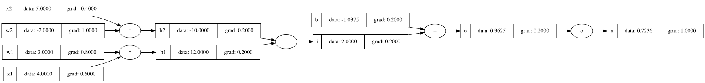

# Scalar Autograd

A tiny automatic-differentiation engine on scalars, in the spirit of micrograd. It is built up in six versions, from a compute graph up to a small neural-network library trained on XOR and Iris.

---

## Theory

Lecture notes for this topic are coming soon on https://parag1604.github.io/notes

## Python Environment Setup

Use Python >= 3.10 and install the requirements:

```bash
pip install -r requirements.txt
```

- Numpy and Matplotlib - plotting decision boundaries
- Scikit-learn - only for the bundled Iris dataset (version 6)
- Graphviz - draws the compute graphs. The python package also needs the Graphviz **system binary** `dot`: `brew install graphviz` (macOS), `sudo apt install graphviz` (Debian/Ubuntu) or https://graphviz.org/download/. Without it the scripts print a hint and skip the drawing; everything else still runs.

## Data

No download needed. Versions 1-5 use hand-written numbers and the four XOR points. Version 6 uses the Iris dataset that ships with scikit-learn (`sklearn.datasets.load_iris`).

## Running

Each `versionN/` folder is a complete snapshot of the engine (`backend.py`), so diffing two consecutive folders shows exactly what was added. Run everything from the repository root:

```bash
python run.py <version_number>
```

Compute graphs are written to `graphs/graph_versionN.svg`.

### 1. A Variable that records the compute graph

```bash
python run.py 1
```

Operator overloading (`+`, `*`, `**` and the reflected versions such as `4 * x`) builds a graph of `Variable`s. Values only, no gradients yet.

### 2. Backpropagation by hand, checked numerically

```bash
python run.py 2
```

Adds `.grad`. The chain rule is applied by hand to `o = d * (a * b + c)`, and each gradient is compared with a central finite difference (`do/da = -4`, `do/db = 6`, `do/dc = 2`, `do/dd = -5`).

### 3. Automatic backpropagation

```bash
python run.py 3
```

Each operation stores a `_backward` closure, and `Variable.backward()` calls them in reverse topological order. The same gradients now come from one call. A second demo, `y = x + x`, shows why gradients must be accumulated with `+=`.

### 4. A single neuron

```bash
python run.py 4
```

Adds the sigmoid operation and builds `a = sigmoid(w1 x1 + w2 x2 + b)`. The compute graph, with values and gradients, looks like this:



### 5. A neural-network library and a training loop (XOR)

```bash
python run.py 5 --epochs 1000 --lr 0.1
```

`nn.py` adds `Module`, `Neuron`, `Layer` and `MLP`. A 2-3-1 MLP (sigmoid hidden layer, linear output) is trained with SGD on the squared error. With the default seed the loss reaches about 0 by epoch 1000, and the decision-boundary plot separates the XOR corners.

### 6. Classification on real data (Iris) with cross-entropy

```bash
python run.py 6 --epochs 25 --activation sigmoid   # or tanh / relu
```

Adds `exp`, `log`, `tanh` and `relu` to the engine. A 4-4-4-1 MLP is trained with binary cross-entropy to separate setosa from versicolor (the first 100 Iris flowers). Training shuffles every epoch, standardizes the features and keeps a 20% test split. With the default seed it reaches 100% train and test accuracy with every activation (these two classes are linearly separable). The plot sweeps the two petal features while holding the sepal features at their mean.

## Related

Suggested order for the neural-network repositories:

1. [Perceptron](https://github.com/parag1604/Perceptron): the perceptron learning rule, its convergence, and where it fails (XOR)
2. [Simple-Neural-Network](https://github.com/parag1604/Simple-Neural-Network): a two-layer network in numpy with hand-written backpropagation, gradient checking and optimizers
3. **Scalar-Autograd** (this repository): a tiny scalar automatic-differentiation engine that automates backpropagation
4. [NN-from-Scratch-to-PyTorch](https://github.com/parag1604/NN-from-Scratch-to-PyTorch): from a numpy MLP to PyTorch autograd, layers and optimizers, ending on MNIST
5. [Basic-Image-Classification](https://github.com/parag1604/Basic-Image-Classification): CNNs in PyTorch on MNIST, Fashion-MNIST and CIFAR-10, with batch norm and dropout
6. [NN-from-Scratch-to-JAX](https://github.com/parag1604/NN-from-Scratch-to-JAX): from numpy linear regression to JAX, Flax and Optax, ending with a CNN on MNIST
